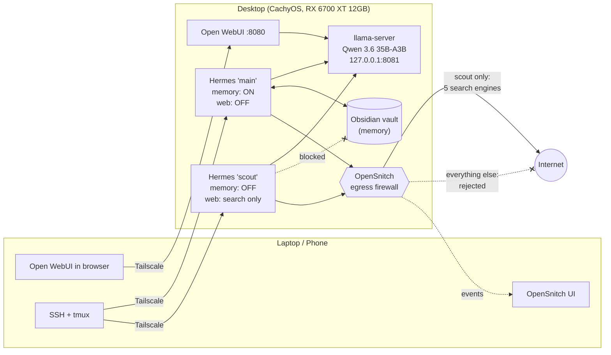

# Secure Local AI Agent

A self-hosted AI agent stack running entirely on consumer hardware: a local LLM, an agent with persistent memory, remote access from a laptop and phone, and a separate web-enabled agent that is technically prevented from leaking private data.

Every security control in this repo was **tested, not assumed**. Several of them exist because testing showed the default behavior was unsafe. See [Lessons learned](docs/lessons-learned.md).

## Why

Cloud AI assistants are convenient, but some data should never leave your machine: logs, notes, personal context. This project answers a practical question: *how do you run a useful AI agent on your own hardware, with real tool access, without it becoming a data leak?*

## Architecture



| Layer | Component | Notes |
|---|---|---|
| Model server | llama.cpp (Vulkan) running Qwen 3.6 35B-A3B (UD-Q4_K_M) | MoE model split across 12GB VRAM and system RAM (`--n-cpu-moe 26`); 128K context; thinking disabled |
| Chat UI | Open WebUI | Talks to llama-server over localhost |
| Agent | Hermes Agent (Nous Research) | Two isolated profiles: `main` and `scout` |
| Memory | Obsidian vault + memory plugin | Plain Markdown, human-readable and auditable |
| Remote access | Tailscale + SSH + tmux | No ports exposed to the internet |
| Egress control | OpenSnitch | Per-process outbound firewall, managed remotely from the laptop |
| Change control | Git on the agent's project files | Every agent edit is reviewable and reversible |

## Threat model

The core risk with an AI agent is the combination of three things in one process:

1. **Access to private data** (memory, notes, files)
2. **Exposure to untrusted content** (web pages and search results can contain prompt injection)
3. **A way to send data out** (web requests, network commands)

An agent with all three can be tricked into exfiltrating data. **This design never puts all three in the same agent.**

| | Private data | Untrusted content | Outbound channel |
|---|---|---|---|
| `main` profile | ✅ | ❌ web disabled | ❌ network commands denied, firewall rejects |
| `scout` profile | ❌ no vault access | ✅ search results | ⚠️ search queries only, to 5 allowlisted engines |

The user is the bridge between the two: research from `scout` is reviewed by a human before anything enters the vault.

## Security controls

| Control | What it does | How it was verified |
|---|---|---|
| Profile isolation | `scout` has its Obsidian memory plugin pointed at an empty directory | Asked scout a question only the vault could answer; no recall, answered from `lspci` instead |
| Command deny list | Blocks `sudo`, `systemctl`, `pacman`, `ssh`, `curl`, `wget`, `python`, `nc`, `socat`, `scp`, `rsync`, `git push/clone`, `/dev/tcp` and more | Patterns confirmed via `hermes config get` |
| Manual approvals | Every flagged command waits for a human yes/no; unattended runs are denied | Config check |
| Write sandbox | `HERMES_WRITE_SAFE_ROOT` limits file-writing tools to specific directories | Config check |
| Toolset reduction | Browser, code execution, delegation, image generation and connections disabled (24 → 14 tools) | Startup banner |
| Fail-closed search | Keyless fallback providers disabled, so a broken search backend stops search instead of silently rerouting | Firewall log showed no traffic to the old fallback provider |
| Egress firewall | OpenSnitch rules: Hermes may reach localhost; only `scout` may reach 5 privacy-respecting search engines; everything else is **rejected** | Event log: allowed engines green, Google/Yahoo/Nous/GitHub red |
| No messaging gateways | Telegram/Discord integrations not enabled; auto-installed gateway service disabled | `pgrep` confirms no gateway process |
| Remote access | Tailscale only; firewall allows ports 8080/22 only on `tailscale0` | `ufw status` |
| Change control | Agent-edited project files are in Git; risky edits moved to deterministic scripts | `git diff` after each session |

## Model comparison

Tested on an AMD RX 6700 XT (12GB VRAM), Ryzen 5 5600, 32GB DDR4.

| | Qwen 3.5 9B (Q5_K_M) | Qwen 3.6 35B-A3B (UD-Q4_K_M) |
|---|---|---|
| Placement | Fully on GPU | GPU + system RAM (`--n-cpu-moe 26`) |
| VRAM / system RAM | ~7.8 GB / — | ~10.7 GB / ~13.7 GB |
| Prompt processing | ~250–400 tok/s | ~220 tok/s |
| Generation | ~30 tok/s (short), ~17 tok/s at 67K context | ~17.7 tok/s |
| Hermes first message | under 1 min | ~53 s (11.8K-token system prompt) |
| Append a log line | ❌ deleted the previous line | ✅ clean |
| Add a task | — | ✅ clean |
| Check off a task | ❌ deleted it, damaged other lines | ❌ deleted it (but reported honestly) |
| Reports its own edits accurately | ❌ claimed false success | ✅ |

**Result:** the 35B is the default. Checking off tasks was moved out of the model entirely and into a deterministic script ([`pdone`](fish/functions/pdone.fish)), because two different models failed the same instruction.

Full details: [docs/benchmarks.md](docs/benchmarks.md)

## Repository layout

```
config/
  systemd/            llama-server user services (35B default, 9B backup)
  opensnitch/rules/   egress firewall rules for Hermes
  hermes/             scripts that apply the main and scout profile settings
fish/functions/       launchers and the pdone helper
prompts/              project-tracker prompt for the agent
docs/
  lessons-learned.md  failure modes found in testing and their fixes
  decisions.md        design decisions and why
  benchmarks.md       model measurements
  runbook.md          daily use, health checks, safe update procedure
```

## Setup

See [docs/runbook.md](docs/runbook.md). In short:

1. Build llama.cpp with Vulkan, download the model, install a service from `config/systemd/`.
2. Install Open WebUI and point it at `http://127.0.0.1:8081/v1`.
3. Install Hermes Agent and the Obsidian memory plugin; run `config/hermes/main-profile.fish` and `config/hermes/scout-profile.fish`.
4. Install OpenSnitch, replace `USERNAME` in the rule files, copy them to `/etc/opensnitchd/rules/`.
5. Install Tailscale on every device.

## Limitations

- Both Hermes profiles run as the same Linux user. Deny-list patterns can be bypassed by a creative command; the egress firewall is the backstop. Next step: run `scout` as a separate user with no access to the home directory.
- OpenSnitch's default action applies when the laptop UI is offline.
- A 35B MoE model on 12GB VRAM needs ~14GB of system RAM; memory pressure is real on 32GB.

## License

MIT
